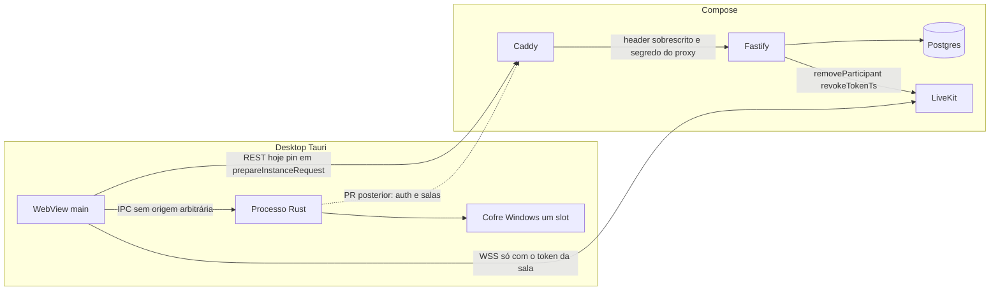
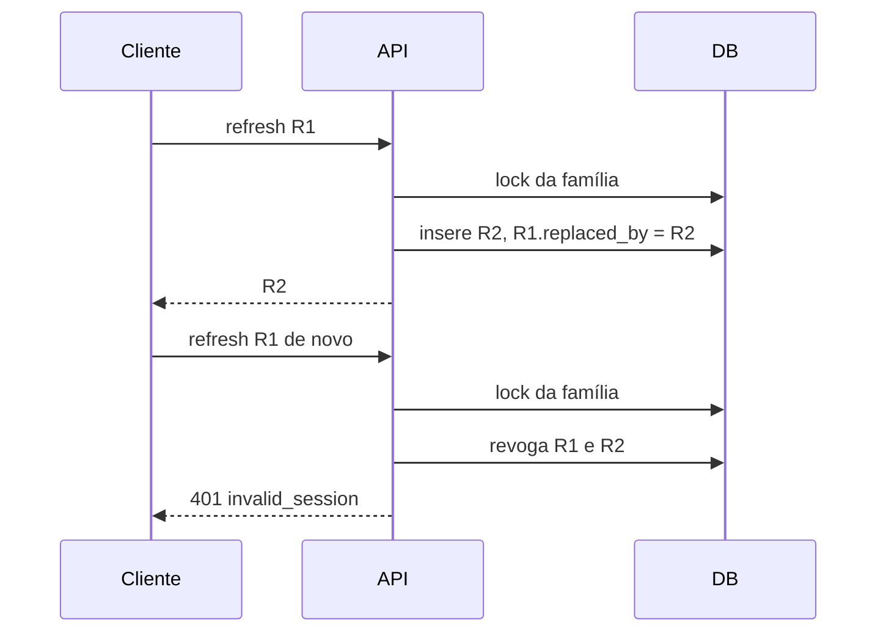

# Correções de segurança S-01 a S-21

| Campo | Valor |
| --- | --- |
| Autor | Grok; fechamento Claude |
| Data | 2026-10-19 |
| Status | Revisado — pronto para virar tarefas |
| Fonte | `docs/reviews/security-audit-2026-10-19.md` |
| Escopo | Desenho. Este documento não altera código. |

## Overview

A auditoria de 2026-10-19 não encontrou um caminho sem credencial até o banco, a sala ou o PC. Os defeitos graves são autorização de administrador acima da membership, sessão que não se revoga por completo, corte de mídia que pode falhar aberto, e um cofre que entrega o refresh da origem que o JavaScript pedir.

A correção mantém o modelo self-hosted: uma instância, sem conta global e sem API paga. Autenticação, TLS e autorização não são afrouxados. O ADR 0005 continua aceitando `connect-src` com `https:` e `wss:` no MVP. O ADR 0006 continua prendendo o access token a uma refresh session e deixando as outras famílias vivas. O que falta é revogação explícita, detecção de reuso e corte de mídia repetível. O item 2 da SPEC (recuperação administrativa) e o RF-11 (a conta só vê o que é membro) passam a ter procedimento e código alinhados. `POC_JOIN` permanece `0` na stack Compose.

## Background & Motivation

Hoje a API é Fastify em `apps/server`, o banco é Postgres via Drizzle, o desktop é Tauri 2 e a mídia é LiveKit. O access token HMAC dura 15 minutos (`ACCESS_TOKEN_TTL_SECONDS` em `apps/server/src/auth/tokens.ts`) e carrega `sub` e `sid`. O refresh dura 30 dias (`startSession`). O JWT da sala dura 10 minutos (`issueRoomToken`, `expiresIn: 600`). A identidade no LiveKit é o `users.id`.

`disabled_at` já existe em `apps/server/drizzle/0001_identity.sql` e já é lido por `login`, `refreshSession` e `currentUser`. Nenhuma rota grava nele. `logout` revoga só o refresh apresentado. `listRooms`, `loadAccess` e `joinRoom` tratam `actor.role === "admin"` como membro de toda sala. `endRoom` e `removeMember` gravam o Postgres e só depois chamam o SFU; se o SFU falha, a API responde `media_disconnect_failed` (502) e o banco não volta atrás. `session_load` em `apps/desktop/src-tauri/src/shell.rs` aceita a origem que o frontend manda.

O ADR 0007 (servidores) está aceito para a F09 e ainda não está no código. Esta correção não cria servidores. Ela impede que o papel `admin` da instância vire um atalho que o ADR 0007 teria de desfazer.

## Goals & Non-Goals

### Goals

- Cada achado S-01 a S-21 tem defeito, impacto e correção concreta, com teste nomeado.
- Admin sem membership não lista sala, não lê sala e não recebe URL nem token.
- Desativar conta, trocar senha e recuperar o administrador estão na API ou num comando de host documentado, e revogam as sessões certas.
- Reapresentar um refresh que já tem `replaced_by` revoga só aquela família.
- Remover membro, encerrar sala, logout e desativação não entregam token novo enquanto o corte no SFU não tiver sido confirmado ou a pessoa já não puder entrar.
- O cofre não devolve refresh de outra origem. O Rust passa a fazer o REST autenticado que o `MeetingModel` chama hoje e não devolve o refresh ao JavaScript. Até o PR das salas, o access token ainda fica na janela.
- A CSP não é alargada. O release não trata `http://127.0.0.1:1420` como origem do aplicativo.
- O grant da sala lista só microfone, câmera e compartilhamento de imagem.
- Username não sai no payload da sala.
- O limite de login deixa de confiar no primeiro `X-Forwarded-For` enviado pelo cliente.
- O token de instalação não é impresso e, depois do bootstrap, não é comparado.
- Backup não fica em SQL claro. `5349` não é publicado sem terminador no mesmo Compose.

### Non-Goals

- Não implementar E2EE. Quem opera a VPS e lê `LIVEKIT_API_SECRET` continua capaz de emitir token. Isso já está dito na SPEC e na auditoria.
- Não implementar ADR 0007, ADR 0010 (Google) nem ADR 0012 (`openmeet://`).
- Não ligar `POC_JOIN`. O entrypoint e o `host.mjs` continuam recusando `1`.
- Não mudar o ADR 0005 para uma lista fixa de instâncias. Não criar proxy local de signaling neste conjunto.
- Não fazer logout de todos os aparelhos a cada refresh. Logout e desativação cortam a identidade LiveKit daquela conta em todo aparelho; as outras famílias de refresh continuam válidas para a API. Isso está na decisão 16, não é efeito colateral.
- Não adicionar mute de outra pessoa na interface. O ensurdecer do ADR 0013 continua local. O corte de moderador que esta correção endurece é remover e encerrar, no SFU.
- Não adicionar plugin de shell, fs, http, opener ou updater.
- Não desligar autenticação, TLS ou autorização para facilitar teste.

## Proposed Design

### Mapa



### S-01 | alta | Administrador entra em qualquer sala sem ser membro

Defeito. `listRooms` (`apps/server/src/rooms/service.ts`) devolve todas as salas quando `actor.role === "admin"`. `loadAccess` não exige membership desse papel. `joinRoom` pula o convite. `issueRoomToken` emite `canPublish` e `canSubscribe` e não grava membership. `canManage` também trata admin como gestor sem membership.

Impacto. A conta de administrador, se usada por outra pessoa, lê e publica em qualquer reunião. Remover a membership não segura esse papel. O RF-11 e o ADR 0007 dizem o contrário: o administrador da instância não enxerga o que não é dele. Na criação de servidor, o ADR 0007 faz dele dono daquele servidor, não visitante de todos.

Correção.

- `listRooms` usa, para todo papel, a query que já existe para não-admin: `memberships` com `removed_at is null`.
- `loadAccess` deixa de ter exceção para admin. Sem membership ativa, `getRoom` e as rotas de gestão respondem `room_not_found` (404), como já fazem para os outros papéis. Não se confirma a existência da sala.
- `joinRoom` deixa de ter o ramo `actor.role !== "admin"`. Sem membership ativa, só um convite válido cria membership, inclusive para admin. Sem convite, `forbidden` (403). A resposta de erro não inclui `url` nem `token`.
- `canManage` passa a ser só membership ativa com `role === "moderator"`. Quem cria a sala já recebe essa linha em `createRoom`. O papel de instância `admin` não gere sala alheia.
- `createRoom` continua permitindo instância `admin` ou `moderator`, e continua inserindo a membership do criador. Participante continua 403.
- Não há lista de suporte e não há entrada excepcional neste conjunto. Ver Open Questions.

Teste. Admin que não é membro: `GET /api/v1/rooms` não inclui a sala; `GET /api/v1/rooms/:id` responde 404; `POST /api/v1/rooms/:id/join` responde 403 com corpo `{ "error": "forbidden" }` e sem `url`, sem `token` e sem `eyJ`. Outra conta que é membro continua entrando. O admin que criou a sala continua membro moderador.

### S-02 | alta | Não dá para bloquear conta nem derrubar as outras sessões

Defeito. `disabled_at` não é escrito. `logout` revoga uma sessão. Não há troca de senha nem o procedimento do item 2 da SPEC. O refresh de 30 dias sobrevive à saída nos outros aparelhos.

Impacto. Refresh roubado continua válido. O operador não corta a conta pela API.

Correção. Revogar todas as sessões é ação explícita. Não acontece dentro de `refreshSession` bem-sucedido. Isso preserva o ADR 0006.

Novas operações, todas com `cache-control: no-store` e auditoria sem senha:

| Operação | Quem | Efeito |
| --- | --- | --- |
| `POST /api/v1/auth/password` | a própria sessão | confere a senha atual com Argon2id, grava o hash novo, revoga todas as `refresh_sessions` da conta e emite uma sessão nova só para quem pediu |
| `POST /api/v1/admin/users/:id/password` | admin da instância, alvo não é ele mesmo | grava o hash, revoga todas as sessões do alvo, não devolve senha |
| `POST /api/v1/admin/users/:id/disable` | admin, alvo não é ele mesmo e não é o único admin | `disabled_at = now()` fica commitado, revoga todas as sessões, liga `livekit_hold` e dispara o corte do S-18. 502 não desfaz `disabled_at`. Repetir o POST chama o SFU de novo enquanto o hold estiver ligado |
| `POST /api/v1/admin/users/:id/enable` | admin | Enquanto `livekit_hold` estiver ligado, responde 502 `media_disconnect_failed` e `disabled_at` permanece. Só com o corte confirmado grava `disabled_at = null`. Não recria sessão |
| `GET /api/v1/admin/users` | admin | `id`, `username`, `displayName`, `role`, `disabled` |

`login`, `refreshSession` e `currentUser` já recusam `disabled`. Com as sessões revogadas, o access token antigo também cai em 401, porque `currentUser` exige a `refresh_sessions` daquele `sid` sem `revoked_at`.

O último admin não pode ser desativado nem ter a senha trocada pelo endpoint administrativo. A própria troca exige a senha atual. Assim um access token de admin roubado não substitui a senha do único administrador.

Recuperação quando esse administrador perdeu a senha. Comando de host, não rota HTTP:

`docker compose exec -T api node dist/db/recover-admin.js`

`docker compose exec` não herda o `DATABASE_URL` que o entrypoint exporta só no PID 1. O serviço `api` não declara essa variável. O script monta a URL a partir de `POSTGRES_HOST`, `POSTGRES_USER`, `POSTGRES_PASSWORD` e `POSTGRES_DB`, que já estão no `environment` do Compose, com o mesmo `encodeURIComponent` do entrypoint. Não imprime a URL, porque ela contém a senha.

A senha nova entra pelo stdin, não por argumento e não por variável de ambiente. O script usa o mesmo `hashPassword` de `apps/server/src/auth/password.ts` (Argon2id, 19 MiB, t=2, p=1), atualiza a única linha `role = admin`, revoga as `refresh_sessions` dessa conta, grava `audit_events.action = admin_password_recover` e não imprime senha nem hash. O procedimento fica em `docs/DEPLOYMENT.md`. Não reabre bootstrap e não lê `BOOTSTRAP_TOKEN`. A desativação e o logout usam a mesma trava do S-04, descrita no S-18.

Teste. Depois de desativar, login, refresh e `GET /api/v1/auth/me` daquela conta respondem 401. Login, refresh e access token de outra conta seguem 200. Troca de senha: o refresh antigo responde 401 e o refresh dos outros aparelhos da mesma conta responde 401; a resposta da troca traz uma sessão nova. Sessão de outra conta permanece. `enable` com `livekit_hold` ligado responde 502 e `disabled_at` continua preenchido. `enable` depois do corte confirmado zera `disabled_at` e não devolve sessão.

### S-03 | alta | Refresh já revogado não derruba a sessão que nasceu dele

Defeito. `refreshSession` trata token revogado ou expirado como `invalid_session` e não caminha por `replaced_by`. O teste em `apps/server/test/auth.test.ts` só exige 401 no token velho. A sessão apontada por `replaced_by` segue até 30 dias.

Impacto. Reapresentar o refresh anterior não invalida quem ficou com o substituto.

Correção. Família de rotação, não logout global.

Migration `0002_session_family.sql`:

- coluna `refresh_sessions.family_id uuid not null`;
- sessões já gravadas: a raiz da cadeia `replaced_by` vira o `family_id` de todos os descendentes; sessão sem pai usa o próprio `id`;
- índice em `family_id`.

`startSession` copia o `family_id` da sessão substituída. No login e no bootstrap, `family_id` é o `id` da linha nova.

`refreshSession`, numa transação:

1. Localiza a linha pelo `token_hash` e lê o `family_id`.
2. `select ... from refresh_sessions where family_id = $1 order by id for update`. O `for update` já é o padrão de `bootstrapAdmin` e de `refreshSession`. Não usar `pg_advisory_xact_lock`: o teste roda em PGlite.
3. Se a linha apresentada tem `replaced_by`, atualiza `revoked_at = now()` em toda a família ainda não revogada e responde `invalid_session`. Não cria sessão nova.
4. Se está revogada sem `replaced_by`, ou expirada, responde `invalid_session` e não mexe nas outras famílias. Logout e expiração não são reuso.
5. Se a conta está desativada, `invalid_session`, sem sessão nova.
6. Caso contrário, insere a sessão nova na mesma família e só então preenche `replaced_by` e `revoked_at` na anterior.

Outra `family_id` do mesmo usuário não é revogada. Dois aparelhos continuam independentes até desativar, trocar senha ou recuperar.



Teste. O refresh substituto passa a responder 401 depois que o token anterior é apresentado de novo. O access token emitido com o substituto responde 401 em `/api/v1/auth/me`. Uma segunda família, criada por outro login da mesma conta, continua 200. Expirar uma sessão sem `replaced_by` não revoga a família irmã.

### S-04 | alta | Remover ou encerrar pode deixar a pessoa na chamada

Defeito. `endRoom` e `removeMember` commitam a decisão e depois chamam `RoomMedia`. `disconnectMedia` transforma falha em `media_disconnect_failed`. O token LiveKit de 10 minutos continua válido se `removeParticipant` não corre com `revokeTokenTs`. Entre o check de `joinRoom` e `issueRoomToken` não há a mesma trava, então um token pode ser assinado depois do corte.

Impacto. Pessoa removida ou sala encerrada pode continuar na mídia. Um join concorrente pode receber token que o corte anterior não cobre.

Correção. A decisão no banco continua, como o teste atual exige. Um único `joinRoom` faz convite, membership e assinatura na mesma trava. O PR deste item depende do PR do S-01. O SFU não segura a transação aberta.

Migration `0003_media_cut.sql`:

- `rooms.media_closed_at timestamptz`;
- `memberships.media_cut_at timestamptz`;
- `memberships.last_token_nbf bigint`;
- `users.livekit_hold boolean not null default false`, usado pelo logout e pela desativação no S-18.

Não há coluna `revoke_at`. Cada tentativa ao SFU recalcula o valor sob `for update`, commita, e só então chama a rede.

`RoomMedia` recebe esse valor em segundos. `roomMedia` em `apps/server/src/rooms/media.ts` deixa de escolher sozinho um `now()`.

```typescript
export interface RoomMedia {
  disconnect(room: string, identity: string, revokeAt: bigint): Promise<void>;
  closeRoom(room: string, revokeAt: bigint): Promise<void>;
}
```

O SDK `livekit-server-sdk` 2.19 (`RoomServiceClient.ts`) documenta `revokeTokenTs` como timestamp Unix que invalida tokens cujo `nbf` é anterior a esse valor. `AccessToken.toJwt()` chama `setNotBefore(new Date())` e não chama `setIssuedAt`. Igualdade não invalida. Por isso o servidor lê o `nbf` do JWT que acabou de assinar, sem logar o token, e grava esse número. `revokeAt` de uma tentativa é `max(last_token_nbf) + 1` das identidades daquele corte. Se ninguém assinou ainda, `last_token_nbf` é nulo e `revokeAt` é `floor(now/1000) + 1`. O valor é sempre estritamente maior que todo `nbf` já persistido para aquela identidade. Em `closeRoom`, o máximo é o da sala.

Ordem de lock, a mesma em join, encerrar, remover, logout e desativar, para não haver deadlock: linha do usuário, depois a refresh session do access token quando houver, depois salas `order by id`, depois memberships. Tudo `for update`.

`joinRoom`, numa transação:

1. Trava o usuário e a refresh session do access token. Se a sessão está revogada ou expirada, ou se `disabled_at` está preenchido, responde 401. Se `livekit_hold` está ligado, não assina. Não é 401 de sessão: a outra família continua válida na API e o join responde `forbidden`.
2. Trava a sala. `ended_at` preenchido, ou encerrada com `media_closed_at` ainda nulo: `room_ended`, sem token e sem convite.
3. Trava a membership. `removed_at` preenchido e `media_cut_at` ainda nulo: `forbidden`, sem token e sem reativar por convite. O corte pendente não é apagado pelo `redeemInvite`.
4. Sem membership ativa, e com o corte já confirmado ou sem linha removida: o convite válido segue a regra atual de `redeemInvite` (convite criado depois de `removed_at`, uso e expiração). Isso ocorre dentro da mesma transação. Sem convite, `forbidden`.
5. Assina o token, lê o `nbf` do payload, grava `last_token_nbf`, grava `room_join`, commit.

`endRoom` e `removeMember`:

1. Transação curta, mesma ordem de lock, grava `ended_at` ou `removed_at` e a auditoria. Lê `max(last_token_nbf)`. Não chama a rede.
2. Commit. Chama o SFU com `revokeAt = nbf + 1` recalculado nessa leitura. Uma repetição refaz o `for update` imediatamente antes da chamada, para ver um `nbf` gravado entre as tentativas. Enquanto o corte estiver pendente, o passo 3 do join impede token novo, então o máximo não cresce por um join da mesma identidade.
3. Sucesso: preenche `media_closed_at` ou `media_cut_at`. 404 do SFU continua ausência (`isAbsent`) e conta como corte confirmado.
4. Falha: 502 `media_disconnect_failed`. A decisão e `disabled_at`, quando for desativação, permanecem. As colunas de confirmação continuam nulas. A repetição chama o SFU de novo.
5. Repetir depois da confirmação responde 204. A primeira repetição que sucede é a que o teste atual conta como segunda chamada ao SFU.

`closeRoom` continua listando participantes, chamando `removeParticipant` com `revokeTokenTs` e só então `deleteRoom`. Identidade vazia continua ignorada.

Teste. O teste "a failed SFU disconnect stays revoked and the retry reaches the SFU again" permanece: banco não volta atrás, `closes === 2`. Acrescentar: o `POST .../join` entre a falha e a confirmação não devolve `url` nem `token`, nem com convite. O mesmo para `removeMember`. Convite depois de `media_cut_at` preenchido ainda reativa, como `redeemInvite` faz hoje. O fake de `RoomMedia` compara `revokeTokenTs` com o `nbf` decodificado do JWT emitido, e exige `revokeTokenTs > nbf`. Não se usa um relógio paralelo no lugar do claim.

### S-05 | alta | O cofre devolve o refresh de qualquer origem que o JS peça

Defeito. `session_load`, `session_save` e `session_clear` usam `keyring::Entry::new("OpenMeet", origin)` depois de `accept_origin`. A capability `default` não amarra origem. `MeetingModel.acceptSession` também guarda o access token na memória da janela.

Impacto. Script na janela `main` pede o refresh de outra instância já salva no cofre do Windows. O efeito depende de script nessa origem. Não há `innerHTML` nem `dangerouslySetInnerHTML` nos fontes lidos.

Correção, em dois PRs. O primeiro fecha a leitura cruzada e cabe numa revisão. O segundo tira o segredo do JavaScript.

PR do cofre:

- Um único item de keyring, conta `active`, não uma entrada por origem.
- O payload é origem canônica mais refresh. A origem passa por `accept_origin` e pelo mesmo formato de `canonicalInstanceUrl` (https com host, ou http só em loopback, sem usuário, senha, path ou query).
- `session_load(origin)` devolve o refresh só se a origem pedida é a origem armazenada. Outra origem `https` responde `invalid_origin` e o erro não contém o token.
- `session_clear` de outra origem não apaga o slot.
- `session_save` substitui o único slot. Trocar de instância apaga o refresh do servidor anterior. A pessoa entra de novo naquele servidor. Isso é perda de sessão, não só recusa de leitura. `MeetingModel.changeInstance` continua sendo o caminho da tela.

A alternativa de manter `Entry::new("OpenMeet", origin)` e ignorar a origem pedida pelo JS está em Alternatives. Ela não entra neste PR: o pin ainda seria movido pelo mesmo webview, e `session_load` ainda devolveria o segredo.

O PR de autenticação nativa, parte do S-06:

- Comandos `session_login`, `session_refresh` e `session_logout` contra a origem do slot, timeout de 10 segundos, sem seguir redirect.
- O JavaScript recebe access token, `expiresIn` e o `PublicUser` só enquanto o PR das salas não tiver saído. O refresh não atravessa o IPC.
- `allow-session-load` sai da capability. `session_load` deixa de existir.
- A senha atravessa o IPC uma vez, no login, e não é gravada nem logada.

O PR das salas, que completa o S-06, tira o access token de `MeetingModel`. Até lá, o residual fica escrito. Não se chama o PR de autenticação de "CSP resolvida".

Teste. Teste Rust puro da decisão de carga: origem diferente é recusada. Teste do comando, com cofre falso: `session_load` de outra origem `https` não devolve o segredo. No PR de autenticação nativa, o tipo de retorno não tem campo de refresh. Trocar a origem do slot não lê um segundo item de keyring, porque só existe um.

### S-06 | média | CSP libera qualquer https e wss

Defeito. `apps/desktop/src-tauri/tauri.conf.json` usa `connect-src` com `https:` e `wss:`. O ADR 0005 aceita isso porque a CSP do Tauri é fixa e cada pessoa escolhe o servidor. `script-src` cai em `'self'`. Não há `unsafe-eval`. `prepareInstanceRequest` em `packages/shared/src/instance.ts` recusa origem diferente da confirmada, mas a CSP não reforça esse pin.

Impacto. Script na origem do app pode abrir conexão com outro host. O cliente normal não manda senha para host diferente do confirmado.

Correção. Não alargar a CSP. Não listar domínios de teste na config versionada. Não adicionar `unsafe-eval` nem `unsafe-inline` em script. O estado final são dois PRs nativos, não um cliente pela metade.

`GET /api/v1/instance` continua no webview: não leva senha nem token. O PR de autenticação move login, refresh e logout para o Rust. Nesse intervalo o access token ainda fica em `MeetingModel`, porque `instancePath` e o webview ainda chamam `POST /api/v1/rooms` e `POST /api/v1/rooms/:id/join`. Isso é residual nomeado. Não é o fim do S-06.

O PR das salas move o que `MeetingModel` chama hoje além da instância: criar sala, listar salas e join. Os comandos são `room_create`, `room_list` e `room_join`. O JavaScript recebe só o URL do signaling e o JWT da sala, e `packages/media` abre o WSS. O access token deixa de ser campo de `MeetingModel`. Rotas de admin e de senha não entram nesses comandos: o desktop não as chama. A CSP permanece a do ADR 0005. Proxy local de signaling fica fora: o ADR 0005 já registra que a mídia continuaria precisando de `wss:`.

Critério de revisão. PR que aumente `connect-src`, `script-src` ou `default-src` não entra.

### S-07 | média | Captura de mídia também vale para a porta de desenvolvimento

Defeito. `is_app_origin` em `apps/desktop/src-tauri/src/lib.rs` aceita `http://localhost:1420` e `http://127.0.0.1:1420` também no binário que não é de debug. O handler responde Allow para microfone, câmera, captura de tela e autoplay. A auditoria não executou o WebView2.

Impacto. Se a janela mostrar essa origem, o Allow de mídia vale fora do `tauri dev`. A severidade no Windows real continua por confirmar, como a auditoria diz.

Correção. Separar origem de release e origem de desenvolvimento, e separar captura de tela de câmera e microfone.

```rust
fn is_bundle_origin(url: &tauri::Url) -> bool {
    // A lista de hoje em is_app_origin, sem a porta 1420 e sem https:
    // scheme "tauri" com host "localhost", ou scheme "http" com host "tauri.localhost".
}
fn is_dev_server(url: &tauri::Url, debug: bool) -> bool {
    debug && url.scheme() == "http"
        && matches!(url.host_str(), Some("localhost") | Some("127.0.0.1"))
        && url.port() == Some(1420)
}
```

No handler: origem que não é bundle nem dev server é Deny. `Microphone`, `Camera` e `Autoplay` são um braço. `DisplayCapture` é outro braço, com a mesma lista de origens. Qualquer outro `PermissionKind` continua Deny. No release, `debug` é falso, então a porta 1420 não recebe Allow. `cfg!(debug_assertions)` alimenta esse booleano; o teste chama a função com o booleano explícito para não depender do perfil do `cargo test`.

Teste. Release simulado: `http://127.0.0.1:1420` é Deny para microfone e para captura de tela. `http://tauri.localhost` é Allow nos dois braços. `https://meet.example` é Deny.

### S-08 | média | A janela não recusa navegação para outra origem

Defeito. `lib.rs` não registra filtro de navegação. A capability gerada está `"local": true` e sem contexto remoto. URL remota não herda estes comandos no modelo do Tauri 2. O risco que fica é a janela passar a mostrar a porta 1420 e cair no Allow do S-07.

Correção. No mesmo PR, `app.windows` sai de `tauri.conf.json`. Não fica janela `main` na config e outra no `setup`. O `setup` cria a única `main` com `WebviewWindowBuilder`, 800×600, antes de `shell::install`, porque `install` faz `get_webview_window("main")`. O label continua `main` para `capabilities/default.json`.

- `on_navigation` devolve verdadeiro só para `is_bundle_origin` ou `is_dev_server`, com o mesmo critério do S-07;
- `on_new_window` devolve `NewWindowResponse::Deny`.

`on_new_window` só existe no builder (Tauri 2.12.4). O hook de plugin cobre navegação da janela criada pela config, mas essa janela deixa de existir. A capability não ganha `remote`. Não se adiciona URL externa.

Teste. Função pura: `https://meet.example` e `http://127.0.0.1:1420` com `debug = false` são navegação recusada. `http://tauri.localhost` é aceita. `http://localhost:1420` só é aceita com `debug = true`.

### S-09 | média | O token da sala sempre pode publicar

Defeito. `issueRoomToken` concede `canPublish: true` sem `canPublishSources`. O cliente pede compartilhamento com `audio: false` em `packages/media/src/session.ts` (`setScreenShareEnabled`). A mesma concessão cobre microfone, câmera, tela e áudio da tela. `canPublishData` é falso e não há `roomAdmin`. Mute de publicação é estado no cliente. O ADR 0013 deixa o ensurdecer local de propósito.

Impacto. Cliente modificado, com conta que já pode entrar, publica fontes que o produto não pediu. Em especial o áudio do PC, que o ADR 0008 mantém desligado até prova.

Correção. Um único helper monta o grant usado por `issueRoomToken` e por `issuePocJoin`, para o POC não ficar mais largo se alguém ligar a flag fora do Compose.

- `roomJoin: true`, `room` igual ao slug, `canSubscribe: true`.
- `canPublish: true` e `canPublishSources` só com as fontes de microfone, câmera e compartilhamento de imagem exportadas por `livekit-server-sdk` (dependência `^2.19.1`). Sem literal numérico solto no serviço.
- Sem áudio de compartilhamento. Sem `canPublishData`. Sem `roomAdmin`, `roomCreate`, `roomList`, `roomRecord`, `hidden`, `recorder` ou `agent`.
- `identity` continua `users.id`. `name` continua o nome de exibição já validado pelo S-21.

O áudio do PC só entra no grant quando o ADR 0008 for implementado e a pessoa marcar a opção. Esse pedido não é aceito do cliente neste PR: o servidor ignora qualquer lista vinda do body.

Remover membro e encerrar sala continuam sendo o corte do moderador, pelo S-04 (`removeParticipant` com `revokeTokenTs`), não por um booleano na tela. Não se adiciona mute de outra pessoa. O mute local do próprio microfone continua em `setMicrophoneEnabled` e não é tratado como barreira.

Teste. `TokenVerifier`, como em `apps/server/test/rooms.test.ts`: as três fontes permitidas estão presentes, a fonte de áudio de tela não está, `canPublishData` é falso e `roomAdmin` não é verdadeiro. O mesmo para o token do POC, sem ligar `POC_JOIN` no Compose.

### S-10 | média | O login da conta aparece para os outros membros

Defeito. `getRoom` seleciona `u.username` e devolve esse campo em `PublicUser`. O username é o identificador do login. A ordenação é `order by u.username`.

Impacto. Membro da sala aprende o login dos outros.

Correção. O payload de membro da sala passa a ser `{ id, displayName, role }`. Sem `username`. Ordenação por `display_name` e `id`. `GET /api/v1/auth/me` e `POST /api/v1/admin/users` continuam devolvendo username para a própria conta e para o administrador da instância. `GET /api/v1/admin/users` do S-02 é o lugar da lista de logins. Nenhuma rota de sala seleciona `users.username`.

O parser de sessão em `packages/shared/src/instance.ts` continua exigindo username no usuário autenticado. Membro de sala não reutiliza `parseUser`.

Teste. `GET /api/v1/rooms/:id` não contém o username de nenhum membro. `/api/v1/auth/me` da própria conta continua contendo o próprio username.

### S-11 | média | Limite de login é memória local e confia no primeiro X-Forwarded-For

Defeito. Com `TRUST_PROXY=1`, `clientAddress` em `apps/server/src/auth/limit.ts` usa o primeiro hop de `X-Forwarded-For`. O mapa em `createAttemptGate` só varre chave expirada depois de 1000 entradas e não tem teto. Não há limite no refresh. O `Caddyfile` não fixa o header. A API não publica a porta 3000 e o Postgres não publica porta. Outro container na rede do Compose que alcance `api:3000` escolhe o IP se o header for aceito.

Impacto. O limite pode ser contornado ou concentrado num endereço falso. O mapa cresce com chaves novas dentro da janela de 15 minutos. Refresh não tem freio.

Correção.

- `host.mjs` gera `PROXY_AUTH` uma vez, no mesmo critério de `AUTH_SECRET` (alfanumérico, pelo menos 32), grava em `infra/compose/.env` e não imprime.
- O Compose passa `PROXY_AUTH` ao serviço `caddy` e ao serviço `api`. Sem isso o Caddyfile não interpola `{$PROXY_AUTH}` e a API não tem com o que comparar.
- O entrypoint recusa subir se `TRUST_PROXY=1` e `PROXY_AUTH` tem menos de 32 caracteres. Não se deixa a API no ar com o limite caído no IP do container do Caddy.
- Caddy, no site da API:

```caddy
reverse_proxy api:3000 {
    header_up X-Forwarded-For {remote_host}
    header_up X-OpenMeet-Proxy {$PROXY_AUTH}
}
```

`header_up` substitui o valor que o cliente tenha mandado. O site do LiveKit não encaminha esse segredo.

- Nas rotas que contam tentativa (bootstrap, login, refresh), `TRUST_PROXY=1` exige `secretsMatch` no header do proxy. Sem o header, com segredo diferente, ou com hop inválido (vírgula, vazio, controle), a resposta é 503 `proxy_rejected`. Não se usa o IP do socket como se fosse o cliente: atrás do Caddy esse IP é o do proxy, e um único balde derrubaria a instância. `GET /health/live` e `GET /health/ready` não passam por essa checagem; o healthcheck do Compose fala com `127.0.0.1` dentro do container. Com segredo certo, `clientAddress` usa o hop único. Não se lê mais o primeiro elemento de uma lista mandada pelo cliente.
- `createAttemptGate` ganha teto de 4096 chaves. Ao passar do teto, remove expiradas. Se ainda estiver no teto, chave nova recebe `allow = false` e não é armazenada. Isso nega login e refresh de um endereço que ainda não estava no mapa, até alguma chave expirar. Chave já presente continua contando. Não se apaga chave viva para abrir espaço. O teto é injetável em `AttemptOptions`, como os outros limites. Só se sobe com evidência de 429 em endereço legítimo.
- Refresh entra na política: 60 pedidos por IP e 12 por hash do refresh apresentado, na mesma janela de 15 minutos. Os números seguem o padrão já injetável de `AttemptOptions`, para o teste não esperar 15 minutos. O cliente legítimo renova uma vez por access token de 15 minutos; 12 no mesmo refresh cobre folga sem abrir mão do giro de uso único.
- `docs/DEPLOYMENT.md` e `docs/ENVIRONMENT.md` passam a dizer que a API não pode ser publicada fora do Caddy. Um teste lê `infra/compose/docker-compose.yml` e falha se o serviço `api` ou `postgres` ganhar `ports`.

Não há segundo proxy suportado na frente do Caddy. Ver Open Questions.

Teste. Sem `PROXY_AUTH` de 32 caracteres no ambiente da API, com `TRUST_PROXY=1`, o entrypoint recusa subir e o serviço `api` não fica healthy. Caddy sem `PROXY_AUTH` é outro teste: o header chega vazio, login, bootstrap e refresh respondem 503 `proxy_rejected` e a API segue healthy. Header ausente ou diferente em login, bootstrap ou refresh: 503 `proxy_rejected`, e o mapa não ganha chave. Segredo certo: o hop único entra no limite. 4097 chaves novas na janela não aumentam o mapa além de 4096 e a chave extra é recusada. O 61º refresh do mesmo IP na janela responde 429. O healthcheck em `127.0.0.1` continua 200.

### S-12 | média | Token de instalação continua reconhecível depois do bootstrap

Defeito. `bootstrapAdmin` compara o token com `secretsMatch` antes de ver `bootstrap_completed`. Token certo com bootstrap fechado tende a `bootstrap_closed` (409). Token errado tende a `bootstrap_rejected` (401). O valor segue no ambiente do container. `publicReport` em `infra/compose/host.mjs` imprime `BOOTSTRAP_TOKEN=` uma vez. O teste `scripts/host.test.mjs` exige essa linha.

Impacto. Antes do primeiro administrador, quem lê o stdout cria a conta. Depois de fechado, a diferença de código confirma se o valor está certo.

Correção.

- `publicReport` não inclui o valor. A linha passa a ser `BOOTSTRAP_TOKEN written to infra/compose/.env`. O arquivo continua modo `0o600`. No Windows, o mesmo PR do S-17 aplica ACL. O teste de host deixa de exigir o segredo no relatório e passa a exigir que o relatório não contenha o valor.
- Se `instance_settings.bootstrap_completed` é verdadeiro, `bootstrapAdmin` não chama `secretsMatch` e a rota responde sempre 404 `{ "error": "bootstrap_closed" }`, com ou sem token, com ou sem corpo válido. `GET /api/v1/instance` continua podendo dizer `bootstrapOpen`, porque a tela precisa do formulário. Isso não compara o segredo.
- A ordem do `docker-entrypoint.sh` muda. A checagem de tamanho do `BOOTSTRAP_TOKEN` hoje ocorre antes de `node dist/db/cli.js` e mata o processo se o valor tem menos de 20 caracteres. O Compose usa `${BOOTSTRAP_TOKEN:?set BOOTSTRAP_TOKEN}`, que falha se a variável está ausente ou vazia. As duas coisas impedem subir a API depois de apagar o token.
- O Compose passa a interpolar `${BOOTSTRAP_TOKEN:-}`. Ausência não impede o `up`.
- O entrypoint mantém as checagens de `AUTH_SECRET`, LiveKit e `POC_JOIN`, monta `DATABASE_URL` e roda a migration. Só então lê `bootstrap_completed`.
- Se o flag está fechado, não há checagem de tamanho. `unset BOOTSTRAP_TOKEN` ocorre depois dessa consulta e antes do `exec node`. O processo não compara o segredo.
- Se o flag está aberto e o token tem menos de 20 caracteres, o processo sobe mesmo assim. A rota responde 503 `auth_unconfigured`. Não se mata o container nessa checagem.
- `host.mjs --clear-bootstrap` só apaga a chave do `.env` depois de ver `bootstrap_completed` fechado. Quem roda o comando é o host. O serviço `postgres` em `infra/compose/docker-compose.yml` não tem `ports`, e `host.mjs` hoje não abre conexão com o banco. A consulta não publica 5432. O canal é `docker compose exec -T postgres psql -U openmeet -d openmeet -v ON_ERROR_STOP=1 -tAc "select bootstrap_completed from instance_settings where id = 1"`. A senha não entra no argumento e o stdout do comando não é o relatório do host. Só a saída 0 com texto `t` apaga `BOOTSTRAP_TOKEN`. Saída diferente de 0, stdout vazio ou `f` deixa o `.env` como está. Recriar o serviço depois do clear tira o valor do `docker inspect`. Enquanto o clear não rodou, `docker inspect` ainda mostra a env do serviço; o `unset` só vale para o processo do Node. A rota fechada não depende do clear para deixar de comparar.

Limite de bootstrap permanece.

Teste. Com `bootstrap_completed`, duas chamadas, uma com o token antigo e outra com outro valor, devolvem o mesmo status e o mesmo corpo. Nenhuma cria usuário. O relatório do host não contém o token gerado. O teste de `--clear-bootstrap` injeta o resultado do exec: `t` com saída 0 remove a chave; `f`, vazio ou saída diferente de 0 não mudam o `.env`. O comando exigido é `docker compose exec -T postgres` e não contém publicação de porta. O teste não abre socket no host.

### S-13 | baixa | Prova de mídia divide a janela com o cofre

Defeito. `apps/desktop/src/App.tsx` importa `PocApp` de forma estática e renderiza quando `?poc=1`. `MeetingApp.tsx` tem `<a href="?poc=1">Prova de mídia</a>` no formulário de instância, fora de `import.meta.env.DEV`. Essa tela fala com a URL digitada e divide origem e IPC com a sessão real. Não lê token na query. Não há `openmeet://` em `tauri.conf.json`.

Impacto. A prova e o cofre estão na mesma janela `main`. Condicionar só o `return` de `App` deixa o link no instalador.

Correção. O instalador não carrega a prova. O import de `PocApp` fica dentro do ramo `import.meta.env.DEV`, não no topo do módulo. O link do formulário também só existe nesse ramo. O build de produção não contém o módulo nem a query. Não se cria webview `poc` no binário instalado e não se copiam os comandos de sessão para outra capability. A prova continua no Compose local `infra/livekit`, no navegador, com portas em `127.0.0.1`.

Teste. O bundle de produção não contém `PocApp` nem `?poc=1`. Em dev, a query continua abrindo a prova.

### S-14 | baixa | `core:default` concede mais do que a tela usa

Defeito. `apps/desktop/src-tauri/capabilities/default.json` inclui `core:default`. No schema gerado, `core:webview:default` inclui `allow-internal-toggle-devtools`. O frontend só importa `invoke` e `listen` (`apps/desktop/src/shell/native.ts`). Bandeja, menu e janela são usados no Rust. `Cargo.toml` não habilita a feature `devtools` e não depende de plugin de shell, fs, http, opener ou updater.

Impacto. A janela `main` pode chamar comandos de núcleo que a tela não usa, inclusive o toggle de devtools concedido pelo conjunto default.

Correção. Trocar `core:default` por:

- `core:event:allow-listen`;
- `core:event:allow-unlisten`;
- `core:webview:deny-internal-toggle-devtools`.

Mais as permissões `allow-session-*` e `allow-shell-*` que já existem. Sem `core:event:allow-emit` e sem `core:event:allow-emit-to`: quem emite `shell-action` é o Rust. Sem permissão de criar janela, esconder janela ou abrir URL. Se um comando de núcleo faltar em runtime, acrescenta-se essa permissão, não o conjunto default.

A capability continua `"local": true` e `"windows": ["main"]`.

Teste. O JSON da capability não contém `core:default` nem `allow-internal-toggle-devtools`. Contém o deny. `listenShell` continua recebendo `shell-action` num teste de UI já existente ou num teste manual registrado como não executado nesta máquina, sem marcar o item como provado no Windows se ninguém abrir o app.

### S-15 | baixa | CSP sem `base-uri`; estilo inline permitido

Defeito. O objeto `csp` não define `base-uri`. `style-src` inclui `'unsafe-inline'`. Os fontes de UI lidos não têm `style=` nem HTML injetado. O estilo está em `apps/desktop/src/App.css`, importado por `App.tsx`.

Impacto. Uma base URI injetada mudaria a resolução de URLs relativas. Estilo inline alarga o que um script na origem consegue fazer com apresentação. Não há HTML injetado hoje.

Correção. Acrescentar `base-uri 'none'`. Remover `'unsafe-inline'` de `style-src`, ficando `'self'`. Se o build mostrar estilo que só existia inline, a regra vai para `App.css`. Não se restaura `unsafe-inline` para contornar isso.

Teste. O `tauri.conf.json` contém `base-uri 'none'` e o `style-src` não contém `unsafe-inline`. O `vite build` do desktop conclui e o CSS empacotado continua a ser arquivo, não atributo.

### S-16 | baixa | Fechar a janela esconde e mantém a sessão

Defeito. `CloseRequested` em `shell.rs` chama `prevent_close` e `hide`. O access token fica na memória do webview até `MeetingModel.endSession`. O item de bandeja `quit` ("Sair") põe `quitting` e chama `app.exit(0)`. Esse caminho não chama `signOut`, não limpa o cofre e não faz `POST /api/v1/auth/logout`. Na abertura seguinte, `restore` lê o refresh e renova a sessão. "Sair da conta" na tela é que chama `signOut`.

Impacto. Fechar a janela parece saída e não é. O rótulo "Sair" da bandeja parece logout e também não é.

Correção recomendada, à espera da decisão em Open Questions. O comportamento de esconder no fechar permanece. O contrato fica visível:

- O rótulo "Sair" existe em `install` e de novo em `replace_menu`. Os dois passam a "Fechar o OpenMeet". Esse item continua saindo do processo sem revogar o refresh.
- Novo item "Sair da conta" nos dois menus emite `shell-action` com `sign-out`. O listener que já existe encaminha para `MeetingModel.signOut`. Não é uma segunda implementação de logout.
- `Preferences` ganha `close_notice_shown`, com `#[serde(default)]`. O teste que hoje espera erro ao ler `{}` passa a aceitar o default falso. `write_consent` e o writer do aviso leem a struct inteira e gravam os dois campos. Gravar só `shortcut_consent` apagaria o aviso, porque o arquivo é substituído.
- Na primeira vez que o fechar esconde a janela, `notify` — o helper que já existe em `shell.rs`, plugin de notificação já ligado — diz que a conta continua neste PC. Sem plugin novo. O aviso não repete.

Se a decisão for encerrar a conta ao fechar, `CloseRequested` e "Fechar o OpenMeet" chamam o mesmo `sign-out` e só então saem. Não se cria um terceiro caminho.

Teste. Com a recomendação: fechar não chama logout; o evento `sign-out` chama o mesmo `endSession` que o botão da tela. Isso pode ser teste do modelo em `packages/shared` mais teste Rust de que `CloseRequested` não põe `quitting`.

### S-17 | baixa | Backup SQL em claro; portas de mídia abertas no host

Defeito. `infra/compose/pg-copy.mjs` grava o dump em `infra/compose/generated`, fora do Git, recusa dump que contenha `POSTGRES_PASSWORD` e usa `mode: 0o600`. No Windows esse modo não vira ACL. O arquivo tem hashes de senha e de sessão. O Compose publica `7881/tcp` e `7882/udp` em todas as interfaces. Isso é o transporte WebRTC, não um segundo login. `infra/livekit/docker-compose.yml` prende as portas em `127.0.0.1`, usa `--dev` e está marcado como local.

Impacto. Quem lê o arquivo no disco lê os hashes. Quem abre as portas de mídia no host além do necessário aumenta a superfície. O compose de POC numa VPS não é configuração de produção.

Correção.

- `BACKUP_KEY` é gerado pelo `host.mjs` como os outros segredos, não é impresso e não é a senha do Postgres. Trocar a chave não reescreve dump antigo. Restaurar um `.sql.enc` exige a `BACKUP_KEY` que estava no `.env` quando aquele arquivo foi gravado. Um `.sql` anterior à cifra restaura como hoje, sem essa chave.
- `assertBackupPath` hoje só aceita caminho que termina em `.sql` dentro de `infra/compose/generated` (`scripts/pg-copy.test.mjs`). O arquivo passa a ser `openmeet.sql.enc`. O backup novo usa um guard que só aceita esse sufixo e recusa `.sql` solto, para o caminho gravado não ser texto claro. A restauração de `.sql` anterior à cifra é um caminho à parte: mesmo diretório `generated`, sem cifra e sem `BACKUP_KEY`, pipe direto no `psql`. `restoreDatabase` escolhe o caminho pelo sufixo; não passa o `.sql` pelo guard do backup.
- Layout, nesta ordem: um byte de versão com valor `1`; IV de 12 bytes; ciphertext AES-256-GCM; tag de 16 bytes no fim. A chave é SHA-256 de `BACKUP_KEY`. O byte de versão recusa arquivo de layout futuro em vez de decifrar lixo.
- Não há SQL intermediário. A busca por `POSTGRES_PASSWORD` corre no plaintext do pipe, antes da cifra. Se aparecer, o `.enc` parcial é apagado e a operação falha.
- Restaurar lê a versão, decifra e manda o plaintext ao stdin do `psql`. Sem arquivo claro.
- No Windows, depois de gravar, `icacls` remove herança e concede leitura só ao usuário atual. O mesmo tratamento vale para `infra/compose/.env`. `0o600` continua para o host Linux.
- `docs/DEPLOYMENT.md` lista o firewall do host: 80/tcp, 443/tcp, 443/udp, 7881/tcp, 7882/udp, e 3478/udp mais 5349/tcp só quando o modo TURN com certificado está ligado. 3000 e 5432 não entram. O repositório não configura o firewall da VPS; o operador aplica essa lista. O compose de POC permanece em loopback e o documento diz para não usá-lo numa VPS.

Teste. O guard do backup aceita `infra/compose/generated/openmeet.sql.enc` e recusa `.sql` e caminho fora de `generated`. Um `.sql` antigo em `generated` restaura sem `BACKUP_KEY`; `.sql` fora de `generated` continua recusado. O arquivo gravado começa com o byte `1` e não contém o texto do dump. Senha do Postgres no pipe apaga o parcial. Chave errada ou versão diferente falha. A restauração de um fixture cifrado devolve o texto. O teste de compose continua sem `ports` em `api` e `postgres`.

### S-18 | média | Sair da conta não corta o token da chamada

Defeito. `logout` só revoga o refresh. O JWT do LiveKit não carrega `sid` e vale até 10 minutos. `MeetingModel.endSession` desconecta a própria mídia. Outra cópia do token não é cortada. Gravar `disabled_at` à mão, como o teste de auth faz, também não chama `removeParticipant`.

Impacto. Logout ou desativação deixam a chamada viva até o token da sala expirar.

Correção. Logout e desativação usam o corte do S-04 para cada sala em que essa identidade tem membership ativa e a sala não está encerrada. A identidade é `users.id`, a mesma de `issueRoomToken`. O JWT da sala não tem `sid`, então o corte vale para todo aparelho dessa conta. As outras famílias de refresh continuam válidas na API.

`currentUser` roda na rota, antes de `joinRoom`. Por isso a trava do join, já descrita no S-04, relê a refresh session e `disabled_at`. Isso não basta para o outro aparelho: a sessão dele não foi revogada. A migration `0003` também acrescenta `users.livekit_hold boolean not null default false`.

Logout, na mesma ordem de lock do S-04:

1. Trava o usuário, põe `livekit_hold`, revoga só a refresh session apresentada (não as outras famílias) e lê as memberships ativas em sala aberta (`removed_at` nulo e `ended_at` nulo), com `max(last_token_nbf)`.
2. Se essa lista está vazia, o mesmo commit desliga `livekit_hold` e a rota responde 204. Não há chamada de rede. O outro aparelho não fica preso em `forbidden`.
3. Se há sala, o commit deixa o hold visível para qualquer join. Fora da transação, `disconnect` por sala com `revokeAt` recalculado. Sucesso ou 404 (`isAbsent`, a mesma ausência do S-04) conta como corte confirmado. Se toda sala confirmou, `livekit_hold` volta a falso e a resposta é 204. Se alguma sala falha com outro erro, 502 `media_disconnect_failed`: o hold permanece e o refresh continua revogado. A sala que já confirmou não impede essa 502.

Um join com outra família válida, enquanto o hold estiver ligado, não assina token e responde 403 `forbidden`. `GET /api/v1/auth/me` dessa família continua 200. Quando o corte confirma, essa família pode entrar de novo com `join` se a membership continuar. Não é logout da API no outro aparelho. 401 fica só para o access token da sessão que o logout revogou.

`logout` com refresh já revogado não cria sessão. Se o hold ainda está ligado, repete o SFU. Se o corte já confirmou, ou se não havia sala aberta, responde 204.

Desativação usa a mesma regra de lista vazia e de 404. Revoga todas as famílias e commita `disabled_at` mesmo quando o SFU falha. Sem sala aberta, o hold baixa no mesmo commit. Repetir `POST .../disable` chama o SFU de novo só enquanto o hold estiver ligado. `enable` responde 502 enquanto o hold estiver ligado e não apaga `disabled_at` nesse caso. Com o corte confirmado, `enable` limpa `disabled_at` e não recria sessão.

`endSession` em `packages/shared/src/meeting.ts` hoje zera a memória, limpa o cofre e ignora o resultado: o `catch` só vê falha de rede, e `api.request` devolve 502 como status, não como exceção. Até o PR 17, a correção olha o status no JavaScript. O cofre só é limpo em 204. Em 502 ou falha de rede o refresh permanece no cofre. O processo repete com espera, sem limite de uma tentativa. Na abertura seguinte, se o refresh da API responde 401, `restore` chama logout com esse refresh antes de apagar o cofre, para completar hold ainda ligado. O refresh revogado não volta a autenticar. O PR 17 move essa regra para o Rust: `session_logout` lê o refresh do slot, não o recebe do JS, só apaga o slot em 204, e 502 ou falha de rede devolvem `media_disconnect_failed` com o slot intacto. A repetição com espera fica nesse comando, inclusive para refresh já revogado.

Teste. Depois do logout, o fake de `RoomMedia` recebeu `disconnect` com `revokeTokenTs` maior que o `nbf` daquele usuário. Access token da sessão encerrada responde 401. Outra família da mesma conta recebe 200 em `GET /api/v1/auth/me` e 403 `forbidden` no join enquanto `livekit_hold` é verdadeiro; depois do corte confirmado, o join emite token. Não se aceita 401 nesse join. Outra conta na mesma sala não é removida. Conta sem membership ativa em sala aberta: logout 204, hold falso, e o fake não foi chamado. 404 do SFU baixa o hold. Falha de uma segunda sala mantém o hold. Desativar deixa `disabled_at` preenchido mesmo com 502. `enable` nesse estado é 502 e não apaga `disabled_at`. O cliente não limpa o cofre nesse 502.

### S-19 | média | O `.env` da stack não está nomeado no ignore do build

Defeito. O Compose constrói a API com contexto na raiz (`infra/compose/docker-compose.yml`) e o Dockerfile faz `COPY . .`. O `.dockerignore` tem `.env` e `.env.*`, não o caminho `infra/compose/.env`. A imagem final só copia `/out`, então o vazamento é contexto e cache de build. A auditoria não rodou o build para provar o matcher.

Impacto. Se o matcher não ignorar esse caminho, o `.env` da stack entra no contexto de build, com senha, `AUTH_SECRET`, chave do LiveKit e token de instalação.

Correção que entra sem prova de daemon. `.dockerignore` é lista de exclusão, não allowlist. O PR acrescenta:

- `infra/compose/.env`
- `infra/compose/.env.*`
- `**/.env`
- `**/.env.*`

O padrão `.env` sem barra já pode casar o nome em qualquer diretório. A auditoria não provou o matcher, então o caminho `infra/compose/.env` fica explícito. O Dockerfile continua `COPY . .` e `pnpm install --frozen-lockfile` na raiz. O estágio final continua copiando só `/out`.

Contexto reduzido não faz parte desse PR. `.dockerignore` só vira allowlist com `*` e depois `!` nos caminhos que permanecem. Um filtro `pnpm install --frozen-lockfile --filter @openmeet/server...` não dispensa o resto do workspace: o lockfile descreve `apps/*` e `packages/*`. Sem um `docker build` registrado com o lockfile atual, o desenho não trata o contexto reduzido como feito. Se esse build for tentado depois, o padrão candidato é `*`, depois `!package.json`, `!pnpm-lock.yaml`, `!pnpm-workspace.yaml`, `!apps`, `!apps/server`, `!apps/server/**`, `!packages`, `!packages/shared` e `!packages/shared/**`. Se o install falhar, entram no `!` os diretórios que o lockfile ainda exige, ou o contexto cheio permanece. Não se muda o Dockerfile neste PR.

Teste. Um teste lê `.dockerignore` e exige os quatro padrões. Isso não prova o daemon.

### S-20 | média | TURN com TLS externo publica a porta sem terminador

Defeito. `TURN_EXTERNAL_TLS=1` em `infra/compose/render-livekit.mjs` grava `external_tls: true` sem certificado. `docker-compose.turn.yml` publica `3478/udp` e `5349` em todas as interfaces. Nenhum arquivo deste repositório sobe o terminador TLS. A imagem oficial `caddy:2.10.2` não traz o módulo L4, então o Caddy atual não termina TLS de TURN. O YAML não tem senha estática de TURN. A autenticação fica no padrão da imagem `livekit/livekit-server:v1.13.10`, que emite credencial efêmera a partir da chave da API para o participante.

Impacto. `5349` publicado nesse modo não tem terminador no Compose. Relay com credencial estática, se alguém a acrescentar, seria configuração longa demais.

Correção.

- `renderLiveKitYaml` recusa `TURN_EXTERNAL_TLS=1` com erro fixo: modo não disponível enquanto o terminador não estiver no mesmo Compose. Não grava `external_tls: true`.
- Recusa `TURN_USERNAME` ou `TURN_PASSWORD` se aparecerem no ambiente. O YAML gerado não pode conter usuário ou senha de TURN.
- `docker-compose.turn.yml` publica só `3478/udp`.
- `docker-compose.turn-certs.yml` publica `5349:5349` além de montar o certificado. Esse é o único modo em que `5349` existe, com `cert_file` e `key_file` dentro do LiveKit.
- `docs/DEPLOYMENT.md` deixa de instruir `TURN_EXTERNAL_TLS=1`.

Quando houver terminador de verdade, ele entra como serviço do mesmo Compose, publica o `5349` e o LiveKit só faz `expose` dessa porta. Isso não é este PR.

Teste. O teste que hoje espera `external_tls: true` passa a esperar erro. YAML com certificado continua sem `external_tls` e sem senha. O arquivo de portas sem certificado não contém `5349`.

### S-21 | baixa | Nome de exibição aceita caractere de controle

Defeito. `parseDisplayName` em `apps/server/src/auth/service.ts` só corta espaço e cobra tamanho de 1 a 80. `createAccount` repete essa regra solta, sem a função. `hasControlCharacter` em `packages/shared/src/instance.ts` só recusa código menor ou igual a 31 e o 127. Isso deixa de fora C1 (`U+0080`–`U+009F`) e os separadores `U+2028` e `U+2029`. `instanceName` usa essa função. O nome de exibição vai para o claim `name` do LiveKit e para o rótulo da chamada. A tela usa texto React, então o efeito é rótulo enganoso, não HTML. `createRoom` aplica a mesma folga ao nome da sala, que os outros membros também vêem.

Impacto. Caractere de controle ou de bidirecional pode falsificar o rótulo visto na chamada ou na lista.

Correção. Uma função em `packages/shared` recusa, depois do trim:

- C0 (`U+0000`–`U+001F`), `U+007F` e C1 (`U+0080`–`U+009F`);
- `U+2028` e `U+2029`;
- `U+061C`, `U+200E`, `U+200F`, `U+202A`–`U+202E`, `U+2066`–`U+2069`.

Não se remove o caractere em silêncio. Nome de exibição inválido é `invalid_display_name`. Nome de sala inválido é `invalid_body`, o código que `createRoom` já usa para nome fora do tamanho. `parseDisplayName`, `createAccount` e `createRoom` usam a função. `issueRoomToken` recusa assinar se o nome de exibição já gravado falhar. O nome da sala entra neste PR: é o mesmo rótulo, a mesma função e o mesmo CHECK. Não fica residual.

`hasControlCharacter` passa a incluir C1 e os dois separadores, para `instanceName` não ficar mais frouxo que o nome da pessoa. Bidi no nome da instância também cai no fallback "OpenMeet".

`[[:cntrl:]]` não entra no CHECK. Classe POSIX segue `LC_CTYPE`, não o encoding. Locale `C` só classifica ASCII, e o teste da API roda em PGlite, que não herda o locale da imagem `postgres:17.6-bookworm`. `U+0085` passaria num banco em `C` e seria recusado só na função. `U+2028` e `U+2029` não são Cc. A migration substitui `users_display_name_length` e `rooms_name_length` por faixas em `chr`, iguais no Postgres e no PGlite. `chr(0)` não entra: o tipo `text` recusa o byte nulo. A função TypeScript continua recusando `U+0000`.

```sql
create function openmeet_without_controls(value text) returns text
language sql immutable parallel safe
as $$
  select translate(
    value,
    (
      select string_agg(chr(code), '' order by code)
      from generate_series(1, 159) as code
      where code <= 31 or code = 127 or code >= 128
    ),
    ''
  )
$$;

alter table users drop constraint users_display_name_length;
alter table users add constraint users_display_name_safe check (
  char_length(display_name) between 1 and 80
  and display_name = btrim(display_name)
  and display_name = openmeet_without_controls(display_name)
  and strpos(display_name, chr(8232)) = 0
  and strpos(display_name, chr(8233)) = 0
  and strpos(display_name, chr(1564)) = 0
  and strpos(display_name, chr(8206)) = 0
  and strpos(display_name, chr(8207)) = 0
  and strpos(display_name, chr(8234)) = 0
  and strpos(display_name, chr(8235)) = 0
  and strpos(display_name, chr(8236)) = 0
  and strpos(display_name, chr(8237)) = 0
  and strpos(display_name, chr(8238)) = 0
  and strpos(display_name, chr(8294)) = 0
  and strpos(display_name, chr(8295)) = 0
  and strpos(display_name, chr(8296)) = 0
  and strpos(display_name, chr(8297)) = 0
);
```

A série `1`–`31` é C0 sem o nulo, `127` é DEL, `128`–`159` é C1 (`U+0085` é `chr(133)`). `rooms.name` recebe o mesmo predicado no lugar de `rooms_name_length`, com o nome da coluna trocado, chamando a mesma função. Se alguma linha violar, a migration falha e o operador corrige o texto. Não há reescrita automática. `chr(8232)` é `U+2028`, `chr(8233)` é `U+2029`, `chr(1564)` é `U+061C`, `chr(8206)` e `chr(8207)` são `U+200E` e `U+200F`, `chr(8234)`–`chr(8238)` são `U+202A`–`U+202E`, `chr(8294)`–`chr(8297)` são `U+2066`–`U+2069`.

Teste. Nome com quebra de linha, DEL, `U+0085`, `U+2028` ou `U+202E` é 400 em bootstrap, criação de conta e criação de sala, e não produz JWT. O mesmo `U+0085` falha no CHECK do PGlite, não só na função. Nome comum de uma a 80 letras, inclusive acento, continua aceito. `INSTANCE_NAME` com controle continua caindo em "OpenMeet".

## API / Interface Changes

Rotas novas:

- `POST /api/v1/auth/password`
- `GET /api/v1/admin/users`
- `POST /api/v1/admin/users/:id/password`
- `POST /api/v1/admin/users/:id/disable`
- `POST /api/v1/admin/users/:id/enable`

`GET /api/v1/rooms/:id` deixa de incluir `username` nos membros.

`POST /api/v1/rooms/:id/join` para admin sem membership passa a 403, sem token.

`POST /api/v1/auth/bootstrap` com bootstrap fechado passa a 404 único, sem distinguir o token.

`POST /api/v1/auth/logout` responde 204 sem rede quando não há membership ativa em sala aberta. Com sala, 404 do SFU também é 204. Outra falha é 502 `media_disconnect_failed` depois de ter revogado o refresh. O cliente, e no PR 17 o comando Rust, só apaga o cofre em 204 e repete enquanto o hold existir. Login, bootstrap e refresh sem o segredo do proxy respondem 503 `proxy_rejected`.

`instancePath` em `packages/shared/src/instance.ts` só libera instance, login, bootstrap, refresh, logout, `/api/v1/rooms` e o join. `readErrorCode` aceita `[a-z_]{1,64}`, então os códigos novos passam. O PR 5 muda `endSession` para olhar o status do logout, caminho que já está na allowlist. Não acrescenta `POST /api/v1/auth/password` nem as rotas `/api/v1/admin/users`. Essas rotas ficam fora de `prepareInstanceRequest` até um PR que desenhe a tela que as chama. O cliente nativo do PR 17 não usa `instancePath`: a allowlist dele é login, refresh e logout. O PR 18 acrescenta criar sala, listar salas e join, e tira esses caminhos do webview.

Comandos Tauri. PR do cofre: mesma superfície, com recusa de outra origem. PR 17: `session_login`, `session_refresh`, `session_logout`. `session_logout` usa o refresh do slot e só apaga o slot em 204. `session_load` sai da capability. O access token ainda volta ao JS. PR 18: `room_create`, `room_list`, `room_join`; o JS recebe URL e JWT da sala, não o access token.

CSP: soma `base-uri 'none'` e tira `'unsafe-inline'` de `style-src`. `connect-src` não muda.

`RoomMedia.disconnect` e `closeRoom` ganham `revokeAt`.

## Data Model Changes

Três migrations, nessa ordem, aplicadas pelo entrypoint antes do processo servir:

1. `0002_session_family.sql` — `refresh_sessions.family_id`.
2. `0003_media_cut.sql` — `rooms.media_closed_at`, `memberships.media_cut_at`, `memberships.last_token_nbf`, `users.livekit_hold`.
3. `0004_display_name.sql` — `CHECK` do nome de exibição e do nome da sala, com a expressão do S-21.

Não se edita `0001_identity.sql`. Rollback de imagem para código que insere refresh sem `family_id` quebra. O rollback desse ponto é restaurar o backup anterior à migration, não só trocar a imagem.

`disabled_at` não muda de forma. Passa a ser escrito.

## Alternatives Considered

1. Admin continua entrando em qualquer sala, com auditoria. Rejeitado. O RF-11 e o ADR 0007 já fecharam esse acesso. Auditoria não desfaz a publicação de mídia.
2. Cada refresh revoga todas as sessões do usuário. Rejeitado. O ADR 0006 deixa as outras sessões vivas de propósito. A correção é família mais ações explícitas.
3. Segurar a transação SQL durante o HTTP ao LiveKit. Rejeitado. A trava cobre a assinatura do token; o HTTP fica fora. A coluna de confirmação torna a falha repetível sem reabrir a janela do join.
4. Lista fixa de hosts na CSP. Rejeitado pelo ADR 0005. A instância é escolhida pela pessoa e a CSP é do build.
5. Access token da API dentro do JWT do LiveKit, para o SFU consultar a sessão. Rejeitado. O LiveKit desta stack não consulta o Postgres da API. O corte é `revokeTokenTs`.
6. `TURN_EXTERNAL_TLS` com Caddy customizado neste PR. Rejeitado. A imagem `caddy:2.10.2` não tem L4, e uma imagem própria aumenta a cadeia de suprimento. O modo fica inválido até o terminador existir no mesmo Compose.
7. Apagar o refresh do cofre ao fechar a janela, sempre. Adiado. É a decisão de produto em aberto. O desenho recomenda manter a sessão da bandeja e deixar isso escrito na interface.
8. Manter uma entrada de keyring por origem, como `Entry::new("OpenMeet", origin)` faz hoje, e ignorar a origem pedida pelo JS, usando só o pin nativo. Preserva o refresh ao trocar de servidor. Rejeitado no PR 15: o mesmo webview move o pin, e `session_load` ainda devolveria o segredo da origem ativada. O slot único impede essa segunda leitura. O custo está na decisão 5: trocar de instância exige entrar de novo no servidor anterior.

## Security & Privacy Considerations

O operador da instância e quem lê `LIVEKIT_API_SECRET` continuam no modelo de confiança do servidor. Não há conta global. Segredos novos (`PROXY_AUTH`, `BACKUP_KEY`) seguem o `.env` da stack, fora do Git, sem stdout.

Ameaças que esta correção reduz, sem descrever procedimento:

| Ameaça | Resposta |
| --- | --- |
| Admin usado para entrar em sala alheia | membership obrigatória |
| Refresh roubado e reapresentado | revoga a família |
| Conta que deveria ter sido cortada | desativar, senha, recuperar |
| Token de sala que sobrevive à saída | `revokeTokenTs` repetível |
| Script na janela lendo outro refresh | um slot e origem conferida; depois, refresh só no Rust |
| Limite de login no IP falso | segredo do proxy e teto |
| Token de instalação confirmado pelo status | resposta única e processo sem a variável |
| Nome que imita outro participante | controle e bidi recusados |
| Dump lido no disco | cifra e ACL |

O username deixa de circular na sala e continua disponível ao administrador da instância, que já cria a conta. Logs de erro continuam no formato atual (`request.log.error({ code }, mensagem)`), sem senha, refresh, access token, JWT, `BOOTSTRAP_TOKEN`, `PROXY_AUTH` ou `BACKUP_KEY`. `userId` pode entrar no log de reuso e de falha de mídia, porque o operador da instância é quem investiga.

`POC_JOIN=1` não volta. Com a flag, a rota existente emite token para a identity pedida em loopback; por isso o Compose e o entrypoint seguem recusando.

## Observability

Não se adiciona coletor externo. O operador lê o log estruturado da API.

Códigos novos, só o nome: `session_reuse`, `media_disconnect_failed` (já é corpo HTTP; passa a ser também log com `roomId`), `proxy_rejected`, `user_disable`, `user_enable`, `user_password_change`, `user_password_reset`, `admin_password_recover`. Esses nomes vão para `audit_events.action` quando houver ator, e para o log quando a ação for recusa de reuso ou falha de SFU.

Alerta operacional, manual neste porte: repetição de `media_disconnect_failed` significa SFU inalcançável e gente que a API já removeu ainda pode estar na mídia até a repetição conseguir. Repetição de `session_reuse` significa refresh reapresentado; a família foi revogada e a pessoa precisa entrar de novo.

O desktop não loga token. Falha de cofre continua `store_failed` ou `invalid_origin`, sem o segredo.

## Rollout Plan

Não há serviço de feature flag. Não há modo que desligue autenticação. A numeração dos PRs não é a ordem de deploy. A ordem mínima está no PR Plan. O que não está nessa lista sai em paralelo.

Numa instância já no ar, antes da primeira migration que adiciona coluna `not null` (`0002_session_family.sql`):

1. Backup. Se o PR do backup cifrado ainda não saiu, o arquivo atual é `.sql` em claro e é tratado como segredo. Esse arquivo continua restaurando como hoje, sem `BACKUP_KEY`. Só um `.sql.enc` exige a chave da época em que foi gravado.
2. Subir a imagem que contém as migrations pendentes. O entrypoint aplica cada arquivo que falta, em ordem de nome. `0004` pode chegar antes de `0002` sem quebrar o runner.
3. Recriar o serviço `api` quando o `.env` ganhar `PROXY_AUTH` ou perder `BOOTSTRAP_TOKEN` via `--clear-bootstrap`. Os dois passos são independentes.
4. Instalador desktop novo para cofre, CSP, navegação e permissões. Instância antiga na API continua falando com desktop antigo, exceto no contrato de membro sem username e nos códigos novos de erro, que o cliente já trata como código em `readErrorCode`.

Rollback. Imagem anterior só é segura se a migration correspondente não tiver sido aplicada, ou se o banco for restaurado. Coluna nova ignorada pelo código velho é segura; `insert` de refresh sem `family_id` não é.

Critério para parar o rollout. `POST /rooms/:id/join` de membro legítimo deixa de emitir token, ou logout passa a revogar sessão de outra conta. Os testes dos PRs cobrem esses dois casos antes do merge.

## Open Questions

1. O administrador da instância pode, algum dia, entrar numa sala da qual não é membro? Recomendação: não. O RF-11 e o ADR 0007 já dizem isso. Se a decisão mudar, a entrada cria membership visível, grava auditoria, usa a identidade real no LiveKit e não emite token sem essa linha. Não há participante oculto. Este desenho não implementa a exceção.

2. Fechar a janela do desktop deve manter a sessão da bandeja? Recomendação: sim. Fechar esconde. "Fechar o OpenMeet" encerra o processo e a próxima abertura restaura o refresh. "Sair da conta" é o único logout. Se a decisão for o contrário, os dois gestos de fechar chamam `MeetingModel.signOut` e só então saem.

3. Haverá um proxy na frente do Caddy? Recomendação: não neste conjunto. Caddy é a borda. Outro proxy só entra quando puder injetar `PROXY_AUTH` e substituir o header de encaminhamento. Até lá, `TRUST_PROXY` só vale para o Caddy da stack.

## Key Decisions

1. Admin sem membership não lista, não abre e não recebe token. Gestão da sala é do moderador da membership, não do papel de instância. Motivo: RF-11 e ADR 0007.
2. Revogar todas as sessões só em desativar, trocar senha e recuperar. O refresh bem-sucedido não mexe nas outras famílias. Motivo: ADR 0006.
3. Reuso é `replaced_by` preenchido e revoga só `family_id`, com `for update` ordenado por id. Motivo: derrubar o substituto sem derrubar o outro aparelho, e o teste roda em PGlite.
4. O banco guarda a decisão de corte; o join não assina fora dessa trava; o SFU confirma em coluna própria. `revokeAt` é o `nbf` persistido do JWT mais um, nunca um `iat` de relógio paralelo. Motivo: o SDK invalida `nbf` estritamente anterior, e o teste de 502 não pode voltar atrás.
5. O cofre tem um slot. Trocar de instância apaga o refresh do outro servidor e exige login de novo. A origem pedida tem de ser a armazenada. O refresh só sai do JavaScript no PR 17, e esse comando só apaga o slot em 204. Motivo: enquanto `session_load` devolve o segredo, uma entrada por origem ainda seria legível se o JS movesse o pin. Apagar o slot ao enviar o logout deixaria `livekit_hold` sem retry.
6. `connect-src` não muda. O PR 17 move só login, refresh e logout, e o access token continua na janela. O PR 18 move criar sala, listar e join; aí o webview fica com o URL e o JWT da sala. Motivo: ADR 0005, e os dois clientes não podem ser especificados ao mesmo tempo.
7. Release não dá mídia à porta 1420. Navegação e janela nova fora do bundle são recusadas. A capability não ganha `remote`. Motivo: S-07 e S-08 se seguram juntos.
8. O grant publica microfone, câmera e imagem de tela. Áudio do PC fica de fora. Sem `roomAdmin` e sem `canPublishData`. Motivo: o cliente já pede `audio: false` e o ADR 0008 não está provado.
9. Username fica em `/auth/me` e na administração. Sai da sala. Motivo: o login não é rótulo da chamada.
10. IP de limite só com segredo do proxy passado ao Caddy e à API. Sem esse header a rota responde 503, em vez de usar o IP do socket. Mapa com teto que recusa endereço novo. Refresh com limite. Motivo: o header do cliente não é prova do endereço, e um único balde no IP do Caddy derruba a instância.
11. Bootstrap fechado não compara segredo. Stdout não imprime o token. O processo dá `unset`. Motivo: 409 contra 401 confirma o valor.
12. `TURN_EXTERNAL_TLS=1` é configuração inválida. `5349` só existe no overlay de certificado. Sem senha estática de TURN. Motivo: não há terminador no repositório.
13. Backup é cifrado no fluxo e, no Windows, ganha ACL. Portas de mídia e 443 são o contrato do firewall, não um serviço novo. Motivo: `0o600` não protege o arquivo nesta máquina.
14. Fechar esconde e o texto da bandeja diz isso. Logout tem um caminho só. Motivo: a bandeja é o contrato atual; o nome "Sair" mente.
15. `?poc=1` não existe no instalador, nem como link no formulário. `POC_JOIN` continua 0. Motivo: a prova não divide o IPC com o cofre, e a rota de POC não aponta para o LiveKit real.
16. Logout e desativação cortam a identidade LiveKit da conta em todo aparelho. As outras famílias de refresh continuam válidas para a API e só recebem token de sala novo depois que `livekit_hold` baixa. Motivo: o JWT da sala não carrega a sessão da API. Não é o mesmo que revogar todo aparelho a cada refresh.

## Risks

| Risco | Severidade | Mitigação |
| --- | --- | --- |
| `family_id` impede rollback só da imagem | alta | backup antes da migration; dito no rollout |
| `revokeAt` igual ao `nbf` deixa o JWT válido | alta | o valor gravado é o `nbf` do JWT assinado; a chamada usa esse número mais um; o teste compara os dois |
| 60 refreshes por IP em NAT pequeno | baixa | número injetável; subir só com evidência de 429 legítimo |
| Teto de 4096 chaves recusa endereço que ainda não estava no mapa | média | mesma saída: teto injetável e evidência de 429 antes de aumentar |
| REST nativo atrasa e o refresh segue no JS | média | o PR do slot já impede a outra origem; o access token na janela dura até o PR 18 e está escrito |
| `core:default` removido quebra `listen` | média | permissões de listen e unlisten explícitas; não restaurar o conjunto |
| Tratar exclusão do Docker como allowlist e quebrar o install | média | o PR 9 só nomeia os `.env`; contexto reduzido espera `docker build` com o lockfile atual |
| `BACKUP_KEY` nova não abre `.sql.enc` antigo | média | só o arquivo cifrado exige a chave da época; `.sql` anterior restaura sem ela |
| Operador não aplica firewall | média | documento e compose sem 3000/5432; a VPS não é configurada daqui |
| S-07/S-08 sem execução no WebView2 | média | a auditoria já marcou isso; o teste Rust cobre a decisão, não o prompt do Windows |

## References

- `docs/reviews/security-audit-2026-10-19.md`
- `SPEC.md` itens 2 e RF-11
- `docs/adr/0005-csp.md`, `docs/adr/0006-session-access.md`, `docs/adr/0007-servidores.md`, `docs/adr/0008-audio-do-pc.md`, `docs/adr/0013-ensurdecer.md`
- `docs/ARCHITECTURE.md`, `docs/DEPLOYMENT.md`, `docs/ENVIRONMENT.md`
- `apps/server/src/rooms/service.ts`, `apps/server/src/rooms/media.ts`, `apps/server/src/rooms/routes.ts`
- `apps/server/src/auth/service.ts`, `apps/server/src/auth/routes.ts`, `apps/server/src/auth/limit.ts`, `apps/server/src/auth/tokens.ts`
- `apps/server/src/instance.ts`, `apps/server/src/poc-join.ts`, `apps/server/drizzle/0001_identity.sql`
- `apps/desktop/src-tauri/src/lib.rs`, `apps/desktop/src-tauri/src/shell.rs`, `apps/desktop/src-tauri/tauri.conf.json`, `apps/desktop/src-tauri/capabilities/default.json`
- `packages/shared/src/instance.ts`, `packages/shared/src/meeting.ts`, `packages/media/src/session.ts`
- `infra/compose/host.mjs`, `infra/compose/Caddyfile`, `infra/compose/docker-compose.yml`, `infra/compose/docker-compose.turn.yml`, `infra/compose/render-livekit.mjs`, `infra/compose/pg-copy.mjs`
- Tauri 2.12.4: `on_navigation` em `WebviewWindowBuilder` e no plugin, chamado por `manager/webview.rs`

## PR Plan

A numeração abaixo não é fila de deploy. Ordem mínima:

- PR 2 antes do PR 4. Os dois reescrevem `joinRoom`; o corte não pode apagar o convite.
- PR 3 e PR 4 antes do PR 5.
- PR 4 antes do PR 6. Os dois mexem no grant dentro da trava.
- PR 15 antes do PR 17.
- PRs 5, 7 e 15 antes do PR 17. O cliente nativo de auth fala com logout 502, limite de refresh e o slot único.
- PR 17 antes do PR 18.

O restante (PRs 1, 8, 9, 10, 11, 12, 13, 14 e 16) é paralelo. Backup antes da primeira migration `not null`, como o rollout diz. `applyMigrations` já aplica arquivo pendente em ordem de nome; `0004` pode existir sem `0002`.

### PR 1 — Recusar controle e bidi no nome de exibição

- Título: `fix(auth): reject control and bidi characters in display names`
- Arquivos: `packages/shared/src/instance.ts`, `apps/server/src/auth/service.ts`, `apps/server/src/rooms/service.ts`, `apps/server/drizzle/0004_display_name.sql`, `apps/server/src/db/schema.ts`, testes de auth e de salas.
- Dependências: nenhuma. A migration `0004` não depende das colunas novas. Pode ser aplicada sozinha.
- Mudança: S-21. A mesma função para nome de exibição, nome da sala e nome da instância. C1 e separadores de linha entram. `issueRoomToken` não assina nome inválido. O CHECK usa `chr` de 1 a 31, 127 e 128 a 159, mais o bidi, e vale no PGlite. Sem `[[:cntrl:]]`.

### PR 2 — Sala só para quem é membro, sem username

- Título: `fix(rooms): require membership and hide usernames`
- Arquivos: `apps/server/src/rooms/service.ts`, `apps/server/src/rooms/routes.ts`, `apps/server/test/rooms.test.ts`.
- Dependências: nenhuma.
- Mudança: S-01 e S-10. Remove o ramo de admin em `listRooms`, `loadAccess`, `joinRoom` e `canManage`. Membro da sala perde `username`.

### PR 3 — Reuso de refresh revoga a família

- Título: `fix(auth): revoke the refresh family on token reuse`
- Arquivos: `apps/server/drizzle/0002_session_family.sql`, `apps/server/src/db/schema.ts`, `apps/server/src/auth/service.ts`, `apps/server/test/auth.test.ts`.
- Dependências: nenhuma de código. A migration `0002` vem antes de qualquer imagem que grave `family_id`.
- Mudança: S-03. Não revoga as outras famílias.

### PR 4 — Corte de mídia repetível e join na mesma trava

- Título: `fix(rooms): block new tokens until the SFU cut is confirmed`
- Arquivos: `apps/server/drizzle/0003_media_cut.sql`, `apps/server/src/db/schema.ts`, `apps/server/src/rooms/service.ts`, `apps/server/src/rooms/media.ts`, `apps/server/test/rooms.test.ts`, `apps/server/test/media-control.test.ts`.
- Dependências: PR 2. Independente do PR 3.
- Mudança: S-04. Um `joinRoom` só, com convite dentro da trava. `revokeAt` maior que o `nbf` gravado. Banco não volta atrás no 502.

### PR 5 — Desativar conta, senha, recuperação e corte no logout

- Título: `fix(auth): disable accounts, reset passwords, and cut media on logout`
- Arquivos: `apps/server/src/auth/service.ts`, `apps/server/src/auth/routes.ts`, `apps/server/src/rooms/service.ts`, `apps/server/src/db/recover-admin.ts`, `docs/DEPLOYMENT.md`, `packages/shared/src/meeting.ts`, testes de auth e de salas. `packages/shared/src/instance.ts` não ganha caminho de admin nem de senha neste PR.
- Dependências: PR 3 e PR 4. A revogação total da desativação é por `user_id`. O logout revoga uma família. O script monta a URL com `POSTGRES_*`.
- Mudança: S-02 e S-18. `livekit_hold` bloqueia token novo até o SFU confirmar. Sem sala aberta, ou com 404 do SFU, o hold baixa e o logout é 204. `enable` com hold ligado é 502 e não apaga `disabled_at`. No JavaScript, o cofre só limpa em 204. Último admin não é desativado por rota.

### PR 6 — Grant só com as fontes autorizadas

- Título: `fix(rooms): limit LiveKit publish sources`
- Arquivos: `apps/server/src/rooms/service.ts`, `apps/server/src/poc-join.ts`, `apps/server/test/rooms.test.ts`, `apps/server/test/poc-join.test.ts`.
- Dependências: PR 4. O helper de token fica dentro da trava que o PR 4 introduz.
- Mudança: S-09. Sem áudio de PC, sem `roomAdmin`, sem `canPublishData`. `POC_JOIN` permanece desligado no Compose.

### PR 7 — Limite atrás do segredo do proxy

- Título: `fix(auth): trust only the stack proxy and cap login attempts`
- Arquivos: `apps/server/src/auth/limit.ts`, `apps/server/src/auth/routes.ts`, `apps/server/src/app.ts`, `infra/compose/Caddyfile`, `infra/compose/host.mjs`, `infra/compose/docker-compose.yml`, `docs/ENVIRONMENT.md`, `docs/DEPLOYMENT.md`, `apps/server/test/abuse.test.ts`, `scripts/host.test.mjs`.
- Dependências: nenhuma.
- Mudança: S-11. `PROXY_AUTH` no Compose para `caddy` e `api`. Boot falha se `TRUST_PROXY=1` sem segredo de 32 caracteres. 503 em vez do IP do socket. Teto de 4096. Limite de refresh. API sem `ports`.

### PR 8 — Bootstrap sem oráculo e sem stdout

- Título: `fix(auth): stop confirming the bootstrap token`
- Arquivos: `apps/server/src/auth/service.ts`, `apps/server/src/auth/routes.ts`, `apps/server/docker-entrypoint.sh`, `infra/compose/docker-compose.yml`, `infra/compose/host.mjs`, `apps/server/test/auth.test.ts`, `scripts/host.test.mjs`, `docs/DEPLOYMENT.md`.
- Dependências: nenhuma.
- Mudança: S-12. 404 único quando fechado. Checagem de tamanho só depois da migration. Compose aceita token vazio. `unset` só com o flag fechado. `--clear-bootstrap` lê o flag por `docker compose exec -T postgres`, sem publicar porta, e só então apaga a chave. Exec com falha ou flag aberto não edita o `.env`.

### PR 9 — Contexto de build sem o `.env` da stack

- Título: `fix(build): keep compose secrets out of the API image context`
- Arquivos: `.dockerignore`, teste que lê esse arquivo. O Dockerfile não muda.
- Dependências: nenhuma.
- Mudança: S-19. Ignorar `infra/compose/.env` e `**/.env` pelo caminho. Sem allowlist e sem `--filter` até um `docker build` com o lockfile atual.

### PR 10 — TURN sem TLS externo e sem 5349 solto

- Título: `fix(turn): refuse external TLS without a terminator`
- Arquivos: `infra/compose/render-livekit.mjs`, `infra/compose/docker-compose.turn.yml`, `infra/compose/docker-compose.turn-certs.yml`, `scripts/livekit-config.test.mjs`, `docs/DEPLOYMENT.md`.
- Dependências: nenhuma.
- Mudança: S-20. `TURN_EXTERNAL_TLS=1` falha. `5349` só no overlay de certificado. Sem credencial estática.

### PR 11 — Backup cifrado e contrato de firewall

- Título: `fix(backup): encrypt dumps and document the host firewall`
- Arquivos: `infra/compose/pg-copy.mjs`, `infra/compose/host.mjs`, `docs/DEPLOYMENT.md`, `scripts/pg-copy.test.mjs`.
- Dependências: nenhuma. Pode aplicar ACL no `.env` que o PR 8 também trata; se os dois se cruzarem, a ACL fica neste PR.
- Mudança: S-17. Sufixo `.sql.enc`, layout com byte de versão, varredura no pipe. Restaurar `.sql.enc` exige a chave da época. `.sql` anterior restaura sem ela. POC `--dev` continua fora da VPS.

### PR 12 — Permissão de mídia e navegação no release

- Título: `fix(desktop): deny dev-server media and foreign navigation in release`
- Arquivos: `apps/desktop/src-tauri/src/lib.rs`, `apps/desktop/src-tauri/src/shell.rs`, `apps/desktop/src-tauri/tauri.conf.json`, testes Rust.
- Dependências: nenhuma. Se sair junto do PR 13, os dois editam `tauri.conf.json`; manter a CSP desse arquivo no PR 13.
- Mudança: S-07 e S-08. `app.windows` sai da config. A única `main` nasce no builder, com `on_navigation` e `on_new_window` Deny, antes de `install`. Sem `https://tauri.localhost`. Sem `remote` na capability.

### PR 13 — Capability mínima e CSP de base

- Título: `fix(desktop): drop core:default and tighten the CSP`
- Arquivos: `apps/desktop/src-tauri/capabilities/default.json`, `apps/desktop/src-tauri/tauri.conf.json`, `apps/desktop/src/App.css` só se algum estilo inline aparecer.
- Dependências: nenhuma. Não misturar com o PR 12 para a revisão da capability ficar legível. Pode ser mergeado em qualquer ordem.
- Mudança: S-14 e S-15. `base-uri 'none'`. Sem `unsafe-inline` em estilo. Deny explícito de devtools.

### PR 14 — Prova fora do instalador

- Título: `fix(desktop): keep the media proof out of the release bundle`
- Arquivos: `apps/desktop/src/App.tsx`, `apps/desktop/src/meeting/MeetingApp.tsx`, teste do bundle.
- Dependências: nenhuma.
- Mudança: S-13. Import de `PocApp` e o link `?poc=1` só no ramo de dev. O bundle de produção não contém nenhum dos dois.

### PR 15 — Cofre de um slot

- Título: `fix(desktop): refuse vault reads for a different origin`
- Arquivos: `apps/desktop/src-tauri/src/shell.rs`, `apps/desktop/src-tauri/permissions/desktop.toml` se o comando mudar, `apps/desktop/src/shell/native.ts`, testes Rust.
- Dependências: nenhuma. Deve sair antes do PR 17.
- Mudança: S-05, primeira parte. Um item `active`. Trocar de instância perde o outro refresh. Outra origem `https` é `invalid_origin` e o erro não leva o token.

### PR 16 — Contrato visível da bandeja

- Título: `fix(desktop): make the tray session contract explicit`
- Arquivos: `apps/desktop/src-tauri/src/shell.rs`, `apps/desktop/src/shell/native.ts`, `apps/desktop/src/meeting/MeetingApp.tsx`, `packages/shared/src/meeting.ts` só se o evento precisar de um método já existente.
- Dependências: nenhuma. Não espera a decisão em aberto: implementa a recomendação (esconder no fechar, logout só em "Sair da conta").
- Mudança: S-16. Os dois menus. `Preferences` com os dois campos e `serde(default)`. Aviso via `notify`. Sem terceiro caminho de logout.

### PR 17 — Login, refresh e logout no processo nativo

- Título: `fix(desktop): refresh the session in the native process`
- Arquivos: `apps/desktop/src-tauri/src/shell.rs`, `apps/desktop/src-tauri/Cargo.toml`, `apps/desktop/src-tauri/capabilities/default.json`, `apps/desktop/src/shell/native.ts`, `packages/shared/src/meeting.ts`. Não edita `tauri.conf.json`.
- Dependências: PRs 5, 7 e 15.
- Mudança: segunda parte do S-05 e o contrato de cofre do S-18. Não completa o S-06. Comandos `session_login`, `session_refresh` e `session_logout`, sem redirect, sem devolver refresh. `session_logout` lê o refresh do slot, não o recebe do JS, e só apaga o slot em 204. 502 e falha de rede preservam o slot e devolvem `media_disconnect_failed`. A repetição com espera fica nesse comando, inclusive para refresh já revogado. `session_load` sai da capability. O access token ainda fica em `MeetingModel` para salas e join. `connect-src` não muda.

### PR 18 — Salas e join no processo nativo

- Título: `fix(desktop): call rooms from the native process`
- Arquivos: `apps/desktop/src-tauri/src/shell.rs`, `apps/desktop/src-tauri/capabilities/default.json`, `apps/desktop/src/shell/native.ts`, `packages/shared/src/meeting.ts`, `packages/shared/src/instance.ts`. Não edita a CSP.
- Dependências: PR 17. Também assume os contratos de sala dos PRs 2, 4 e 6, porque o comando de join fala com esse `joinRoom`.
- Mudança: completa o S-06. Comandos `room_create`, `room_list` e `room_join`. O JavaScript recebe o URL do signaling e o JWT da sala. `MeetingModel` deixa de guardar access token. `GET /api/v1/instance` continua no webview. Rotas de admin continuam fora do `prepareInstanceRequest`.
